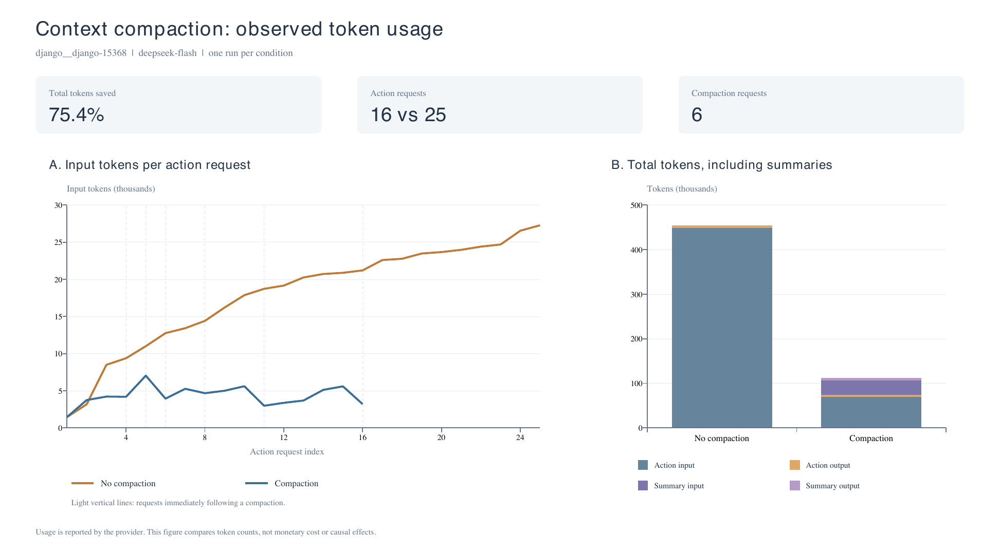

# Part 2：上下文压缩与非压缩对比

本报告比较同一任务 `django__django-15368` 的两次运行，模型均为 `deepseek-flash`。数据来自[压缩轨迹](django__django-15368-trajectory.json)和[非压缩轨迹](django__django-15368-baseline-trajectory.json)；每个条件只有一次运行。压缩组触发了 6 次压缩，非压缩组没有压缩事件。

两组均生成补丁并调用 `send_message` 提交；[压缩补丁](django__django-15368.patch)与[基线补丁](django__django-15368-baseline.patch)逐字节相同。本报告未核对独立的 `check-swebench` 评测结果，因此不把提交成功等同于全部评测通过。

## 图表与统计

左图只统计动作请求的输入 token，浅色竖线表示压缩后的下一次动作请求。横轴是各自运行中的请求序号，两组同一序号不一定执行相同动作。右图将动作和摘要请求的输入、输出全部计入。

| 指标 | 压缩 | 非压缩 |
|---|---:|---:|
| 动作请求次数 | 16 | 25 |
| 摘要请求次数 | 6 | 0 |
| 动作请求输入 token | 69,052 | 448,448 |
| 动作请求输出 token | 4,605 | 6,249 |
| 摘要请求输入 token | 32,539 | 0 |
| 摘要请求输出 token | 5,764 | 0 |
| 全部输入 token | 101,591 | 448,448 |
| 全部输出 token | 10,369 | 6,249 |
| **总 token** | **111,960** | **454,697** |
| 单次动作请求最大输入 token | 7,033 | 27,273 |
| 动作请求平均输入 token | 4,315.8 | 17,937.9 |

统计口径：动作消耗取自 `responses[].usage`，摘要消耗取自 `compactions[].compaction_response.usage`。总 token 是两类请求的 `prompt_tokens + completion_tokens` 之和；不会把 `total_tokens` 再重复相加。缓存命中的输入仍计入输入 token。

## 观察到的趋势

非压缩组的动作输入从 1,454 增长到 27,273 token；历史不断累积，后面的请求需要重复携带更长的对话。压缩组的曲线随摘要生成而多次回落，动作请求最大输入为 7,033，比非压缩组的 27,273 低 74.2%。

压缩事件的上下文变化如下。这里的 before/after 是代码基于序列化消息长度得到的粗估值，用于衡量同一次压缩的幅度；它们不同于模型服务返回的实际 token 数，也不完全等同于触发阈值时的校准估算。

| 压缩后对应的动作请求序号 | 压缩前粗估 | 压缩后粗估 | 降幅 |
|---|---:|---:|---:|
| 4 | 5,771 | 3,327 | 42.3% |
| 5 | 8,405 | 6,525 | 22.4% |
| 6 | 8,345 | 2,997 | 64.1% |
| 8 | 6,982 | 3,700 | 47.0% |
| 11 | 5,411 | 2,040 | 62.3% |
| 16 | 5,582 | 2,252 | 59.7% |

计入摘要开销后，压缩组总量为 111,960，非压缩组为 454,697，本次总 token 减少 **75.4%**。但摘要本身消耗了 38,303 token；全部输出反而由 6,249 增加到 10,369。压缩降低了后续输入的重复传输，同时增加了生成摘要的开销。

## 上下文使用的权衡

- **上下文长度与信息保真。** 摘要降低了活跃上下文长度，为后续工作留出空间；原始细节会被筛选，遗漏文件、约束或测试结论可能导致重复探索或错误判断。本次两组最终补丁相同，但这不能证明摘要保留了所有有用细节。
- **重复输入与摘要开销。** 长历史在后续每次请求中都会再次传入，压缩可以减少这种累积；频繁压缩则需要反复读取旧历史并生成摘要。阈值越低通常越早介入，也可能增加摘要调用，不能只根据单次上下文变短就断言总量更低。
- **token 数量与实际费用。** 压缩组全部输入的缓存命中数为 48,256（47.5%），非压缩组为 426,240（95.0%）；对应未命中输入为 53,335 与 22,208。本次非压缩组有更多可复用输入。由于缓存、未缓存输入和输出的计价可能不同，不能把 75.4% 的 token 减少直接解释为相同比例的费用下降；这里不估算费用。
- **实验结果与因果解释。** 压缩组用了 16 次动作请求，基线用了 25 次；基线轨迹也包含更多、范围更广的测试命令。两组执行路径不同，加上生成的随机性，不能把全部步数差异归因于压缩，也不能据一次对比断言压缩总会更省。

本次可直接确认的是：压缩组呈现更短的活跃上下文和更低的总 token 数，两组提交了相同补丁；其可靠性、独立评测表现和实际费用仍需各自证据支持。
